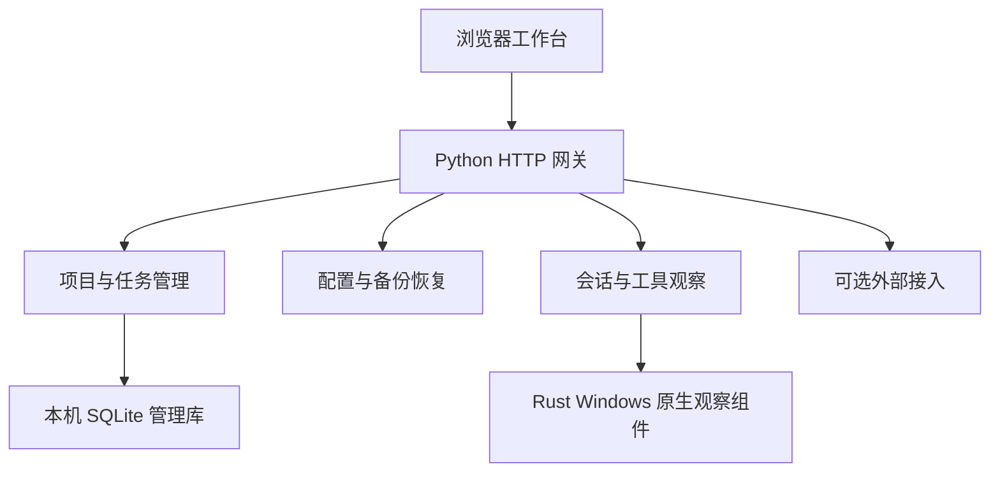

# 架构说明

Control Everything 由浏览器界面、Python 管理后端和 Windows 原生观察组件组成。管理数据保存在本机；远端会话、外部工具和资讯按各自的接入配置访问。

## 组件与数据流

- HTTP 网关绑定本机回环地址，处理请求校验、权限和模块装配。浏览器通过 HTTP 获取数据与静态资源。
- Python 负责项目、任务、进度和配置。跨项目与任务的关联修改在同一数据库事务中完成。
- Rust 负责 Windows 进程观察、受限本机管道和核验后的窗口返回，不写业务数据库。观察到进程存在不代表 Agent 正在执行任务。
- 本机 Codex 项目适配器位于 `sessions/codex_desktop.py`，只读显式选择的数据库与相邻桌面配置。它先归一化项目身份和会话归属；工作台服务负责项目投影、来源状态和会话分页。会话标题与项目归属不代表实时执行或任务完成状态。
- 源码或普通 Python wheel 缺少原生组件时，基础管理仍可使用，原生观察显示受限。完整 Windows 产品另外打包匹配的运行时和原生组件。

## 源码归属

后端采用 Python 的 `src` 布局，唯一包名为 `control_everything`。`src/` 区分可安装源码与仓库工具；包内再按功能划分，目录名不代表产品只支持会话面板。

| 路径 | 职责 |
| --- | --- |
| `src/control_everything/http` | HTTP 路由、静态资源白名单与服务装配 |
| `src/control_everything/workspace` | 项目、任务、人工进度、管理存储与资讯 |
| `src/control_everything/sessions` | 会话索引、工具进程观察与终端证据 |
| `src/control_everything/profiles` | 配置、数据目录、导入、备份与离线恢复 |
| `src/control_everything/integrations` | 外部服务、固定启动器与只读 MCP 适配 |
| `src/control_everything/execution` | Codex / DSH 受控执行、工具审批、运行归属与清理；当前为源码开发版入口 |
| `src/control_everything/installation` | Windows 产品清单、所属登记和安装维护 |
| `src/control_everything/platform` | Windows Job、句柄与安装身份原语 |
| `web/sessions`、`web/progress`、`web/workspace` | 三组页面及其脚本、样式 |
| `native/observer` | Rust 原生观察组件 |
| `tools` | 构建、开发脚本、架构检查及固定工具配置 |
| `tests/backend`、`tests/frontend`、`tests/e2e`、`tests/fixtures` | 后端、前端、端到端验证与合成数据 |

前端以普通 HTML/CSS/JavaScript 为主。观察与资讯模块由相邻 TypeScript 源码生成 JavaScript，交付时包含生成结果，普通用户启动无需 Node.js。页面主脚本负责状态和装配，完整业务展示放入所属模块。

## 依赖与扩展边界

HTTP 层可以装配各功能包，功能包不能反向依赖 HTTP。会话观察不依赖管理层；项目管理可以使用会话证据，但不调用执行或配置装配层。安装模块只由 HTTP 装配层调用，底层原语不反向依赖业务。

具体约束以 [Import Linter 配置](../tools/architecture/importlinter.ini) 为准。新增功能先选择已有职责目录；涉及前后端时分别落入各自模块，不在根目录建立第二份 Python 包或前端源码。

## 资源、数据与分发

- [paths.py](../src/control_everything/paths.py) 区分源码检出、已安装包资源与用户数据目录。运行数据不写入安装包目录。
- Web 资源只维护一份源码，构建 Python 包时按 HTTP 白名单复制。物理文件移动不能随意改变公开页面和资源 URL。
- 管理库 schema、配置格式和备份格式独立版本化；旧库通过显式命令迁移，不在 HTTP 启动时隐式升级。
- 三工具项目读取时仅产生候选，用户显式加入时才在同一管理事务内保存项目、目录和来源。Codex 事项关联继续在同库事务内校验。关联复用现有管理表与备份闭包，不升级 schema；外部同目录项目可独立保存，手工项目仍保留原目录冲突校验。外部来源失效不会删除已有事项。
- Python wheel 包含管理后端和必要 Web 资源；Windows 安装器额外组合运行时、原生观察组件和维护入口。安装器的具体操作与限制见 [Windows 安装与维护](windows.md)。

开发环境、检查命令和提交约定见[参与开发](../.github/CONTRIBUTING.md)；配置及数据恢复操作见[使用指南](usage.md)。

项目发现、读取许可和加入工作台分别处理。Codex 沿用原许可字段；Claude Code/OpenCode 的许可与移出 ID 集合保存在 profile v4，v5 增加本机 Agent 注册身份与可选 project_ids 范围。已存项目默认保留，未保存的外部发现不自动进入导航。移出只写配置，不删除业务记录；首次加入只写管理库，合法悬空移出 ID 需要第二次配置请求重新加入。当前业务 schema9 与备份 manifest9 对应；agent_runs/task_events 记录领取、进度、等待人工/授权和审核证据；task_briefs/task_dispatches 记录版本化说明与人工确认的派发快照；task_sessions 只存外部会话元数据与 source_instance，不存正文；task_messages 记录人工补充/退回/等待人回答的手动交接状态；execution_runs/execution_events/execution_approvals 在同一管理库记录真实执行、事件及工具审批。连接未知只提示，不释放运行或任务，不表示宿主执行或自动完成。
